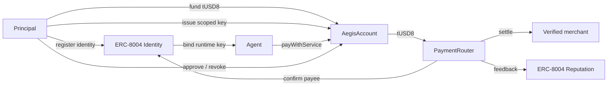

# AegisPay — Policy-Guarded Agentic Stablecoin Payments

**Aevum Builder Challenge #1 (QDay)** · 100% original code · MIT licensed · open source

> Let agents pay. Keep the keys.

An autonomous agent pays tUSD8 invoices for verified merchants on the QDay Aevum testnet — but only inside a budget, a time window and a payee allowlist. Large payments need a human's single-use approval. One transaction revokes everything.

## Why this idea

Judging weights innovation highest (20/100). AegisPay makes the **agent itself** the subject of the safety story: an identity-bound, least-privilege economic actor. It combines three official tracks — **Native AI Assistants**, **Confirmation of Payee**, and **Decentralized Payments** — in one reproducible flow. Full ideation and scoring: [`docs/IDEATION.md`](docs/IDEATION.md).

## What it does



1. Principal registers an ERC-8004 identity for the agent and binds its runtime key.
2. Factory creates one tUSD8 smart account per principal; principal deposits faucet funds.
3. Principal issues a **session key**: total cap, per-tx cap, expiry, optional payee lock, approval threshold.
4. Agent pays a merchant via `payWithService(merchant, amount, invoiceId)`.
5. Router verifies the merchant's ERC-8004 identity (**Confirmation of Payee**), forwards tUSD8, and writes reputation receipts for both sides.
6. Payments above the threshold require `approvePayment(...)` — a **single-use** human approval.
7. `revokeSession(agent)` is an instant kill switch.

## Repository layout

| Path | Contents |
|---|---|
| `src/AegisAccount.sol` | Smart account, session policies, approvals, revocation |
| `src/PaymentRouter.sol` | Merchant registry, Confirmation of Payee, settlement |
| `src/AegisFactory.sol` | One account per principal |
| `src/interfaces/`, `src/mocks/` | Minimal ERC-8004/ERC-20 interfaces and testnet adapters |
| `test/` | 21 Foundry tests, including all failure paths |
| `script/Deploy.s.sol` | Deploy stack (real tUSD8 on chain 44005) |
| `script/DemoFlow.s.sol` | Local Anvil end-to-end walkthrough |
| `demo/index.html` | Responsive interactive UI with simulation + plain-language errors |
| `demo/agent-runner.mjs` | Live testnet runner with retries, receipts and explorer links |
| `docs/` | Ideation, architecture, demo script, submission, originality |

## Network configuration

| Item | Value |
|---|---|
| Network | QDay Aevum Testnet |
| Chain ID | **44005** |
| RPC | `https://rpc-test.qday.info` |
| Explorer | `https://explorer-test.qday.info` |
| tUSD8 | `0x456569838f1d43009A91ebA4263147Afd7233483` (**6 decimals**) |
| Faucet | `https://faucet.qday.info/en` (or Discord `#faucet`: `/faucet <address>`) |
| Discord | `https://discord.gg/bYPhjmrSfK` |

> **Aevum gotcha:** compile with `evm_version = "shanghai"`. Cancun builds deploy but fail with `invalid opcode: MCOPY`. Contract verification is not available yet — link this repo and the deployment transaction instead.

## Quick start

```bash
git clone https://github.com/aishwaryanevrekar/aegispay.git
cd aegispay
make install     # installs forge-std as a submodule
make test        # 21 tests, all passing
make demo        # local Anvil end-to-end run (prints balances + receipts)
node demo/simulate.mjs   # offline walkthrough, no wallet needed
```

Requires Foundry: `curl -L https://foundry.paradigm.xyz | bash && foundryup`. On macOS network volumes, `make` first removes AppleDouble `._*` files that would otherwise break `solc`.

## Live testnet deployment

The stack is **already deployed** on Aevum with a full on-chain demo — see [`docs/LIVE_DEPLOYMENT.md`](docs/LIVE_DEPLOYMENT.md) for addresses and transaction hashes. To redeploy yourself:

```bash
cp .env.example .env
# fill PRIVATE_KEY (testnet only) and get 1 tQDAY + 5 tUSD8 from the faucet
export $(grep -v '^#' .env | xargs)
make deploy     # forge script script/Deploy.s.sol --rpc-url $AEVUM_RPC_URL --broadcast
```

`deployments/44005.txt` records the deployed identity, reputation, router and factory addresses. Put them in `.env`, then:

```bash
npm install
node --env-file=.env demo/agent-runner.mjs
```

The runner prints every transaction hash with an explorer link, waits for receipts, retries RPC failures, verifies the payee, executes the two invoices, reads reputation and revokes the key.

### Environment variables

See [`.env.example`](.env.example). Required: `AEVUM_RPC_URL`, `PRIVATE_KEY`, `AGENT_PRIVATE_KEY`, `MERCHANT_PRIVATE_KEY`, and the four deployed addresses. Optional: explorer URL, payment amounts, session duration. **Never commit `.env`.**

## API reference

| Contract | Method | Purpose |
|---|---|---|
| `AegisFactory` | `createAccount() → address` | Get/create principal account |
| `AegisAccount` | `deposit(uint256)` | Fund with tUSD8 (requires ERC-20 approval) |
| `AegisAccount` | `issueSession(agent, agentId, totalCap, perTxCap, expiry, recipient, approvalThreshold)` | Delegate limited authority |
| `AegisAccount` | `approvePayment(agent, recipient, amount, nonce)` | Pre-approve one high-value payment |
| `AegisAccount` | `payWithService(merchant, amount, serviceRef)` | Agent settlement call |
| `AegisAccount` | `revokeSession(agent)` | Kill switch |
| `PaymentRouter` | `registerMerchant(name, identityId)` | Confirmation of Payee |
| `Identity` | `register(uri)`, `setAgentAddress(id, addr)` | ERC-8004 identity binding |
| `Reputation` | `getSummary(agentId)` | Verify feedback count/score |

Full details, threat model and roadmap: [`docs/ARCHITECTURE.md`](docs/ARCHITECTURE.md).

## Safety

Least-privilege sessions, strict caps, expiry, payee allowlists, identity binding, single-use approvals, instant revocation, and a `PaymentExecuted` nonce for a gap-free on-chain audit trail. The agent cannot call arbitrary contracts and never holds the funds itself.

## Docs

- [Ideation & selection](docs/IDEATION.md)
- [Architecture & threat model](docs/ARCHITECTURE.md)
- [Live deployment + tx hashes](docs/LIVE_DEPLOYMENT.md)
- [Demo video script (2–3 min)](docs/DEMO_SCRIPT.md)
- [DoraHacks submission text](docs/SUBMISSION.md)
- [Originality & licensing](docs/ORIGINALITY.md)

## License

MIT — see [LICENSE](LICENSE).
