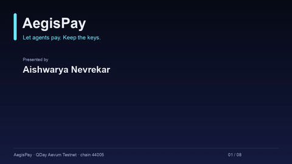
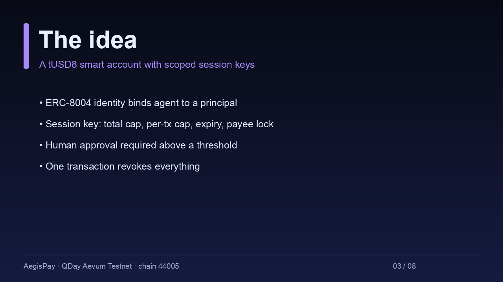
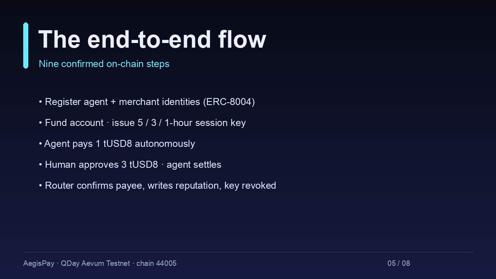
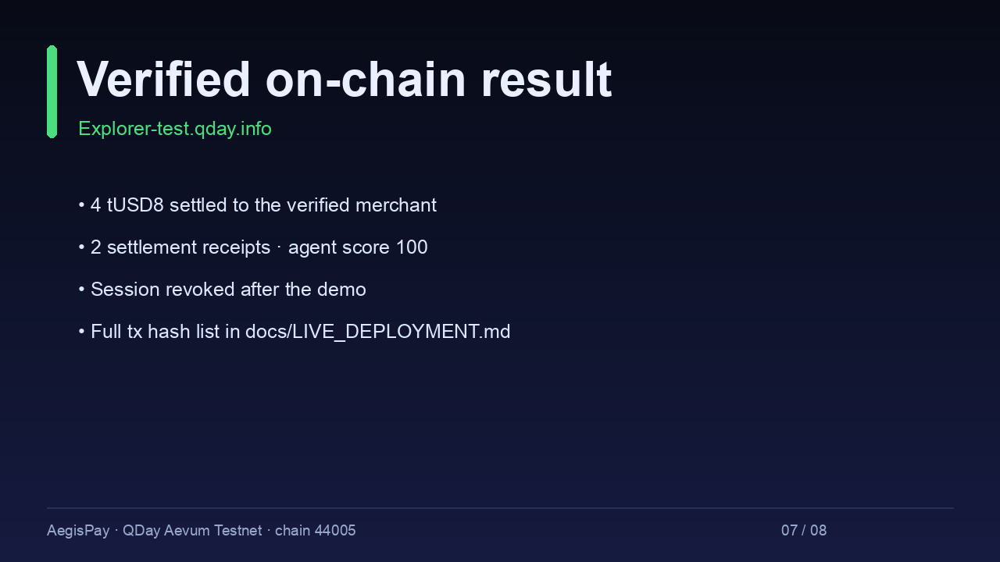
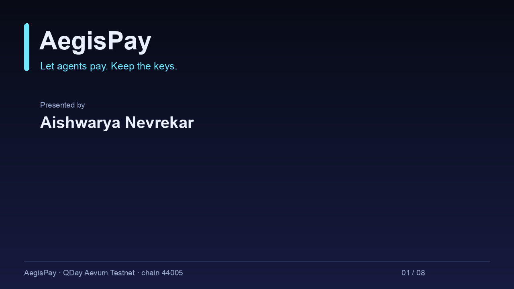
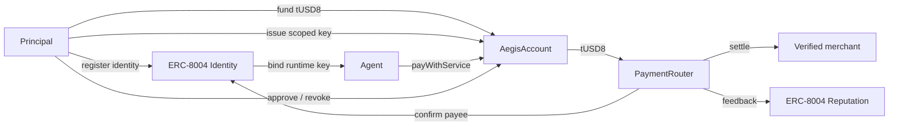

# AegisPay — Policy-Guarded Agentic Stablecoin Payments

**Aevum Builder Challenge #1 · QDay** · Built by **Aishwarya Nevrekar** · 100% original code · MIT licensed

> **Let agents pay. Keep the keys.**

An autonomous agent settles tUSD8 invoices for verified merchants on the QDay Aevum testnet — but only inside a budget, a time window and a payee allowlist. Large payments need a human's single-use approval. One transaction revokes everything.

**✅ Live on Aevum (44005) · ✅ 21/21 tests · ✅ 12 confirmed transactions · ✅ Video ready**

---

## 📌 About

AegisPay is a tUSD8 smart-account system for the QDay Aevum testnet that lets an AI agent pay merchants **safely**. Instead of giving an agent a full private key, the human principal registers an ERC-8004 identity for the agent and issues a scoped session key with a spending budget, per-transaction cap, expiry date, and payee allowlist. Payments above a threshold require a single-use human approval, and the principal can revoke the key instantly.

The project was built from scratch for **Aevum Builder Challenge #1** by **Aishwarya Nevrekar**. It spans three official tracks — Native AI Assistants, Confirmation of Payee, and Decentralized Payments — and every component (contracts, tests, UI, docs, video) is original and MIT licensed.

---

## 🔎 Tags & discoverability

These tags connect the project to the hackathon, the chain, the standards used, and the problem it solves. They are used in this README, in the YouTube description, and as GitHub repository topics.

| Group | Tags | Why it matters |
|---|---|---|
| **Event & network** | `#Aevum` `#QDay` `#tUSD8` `#AevumBuilderChallenge` `#DoraHacks` `#Hackathon` `#QDayTestnet` | Links the build to the exact hackathon, chain (44005) and official stablecoin judges are looking for. |
| **Smart-contract stack** | `#Solidity` `#Foundry` `#EVM` `#SmartContracts` `#OpenZeppelin` `#Viem` | Helps Solidity/Foundry developers find and reproduce the work. |
| **Account abstraction** | `#SmartAccount` `#AccountAbstraction` `#ERC4337` `#SessionKeys` `#SpendCaps` `#KillSwitch` | Signals the core technical contribution: scoped, revocable delegation. |
| **Identity & standards** | `#ERC8004` `#ConfirmationOfPayee` `#ReputationRegistry` `#IdentityBinding` | Maps directly to the official Confirmation of Payee track and identity primitives. |
| **Agents & payments** | `#AgenticPayments` `#AIAgents` `#AutonomousAgents` `#AgenticCommerce` `#ProgrammablePayments` `#Stablecoin` `#DecentralizedPayments` `#Payments` `#DeFi` | Reaches the Native AI Assistants and payments audience. |
| **Safety & trust** | `#LeastPrivilege` `#HumanApproval` `#AuditTrail` `#SessionExpiry` `#Web3` | Highlights the safety criteria weighted by the judges. |
| **Open source** | `#OpenSource` `#MIT` `#BuildInPublic` | Makes the licensing and originality explicit. |

**All tags in one line (paste into YouTube / GitHub topics):**

`Aevum, QDay, tUSD8, AevumBuilderChallenge, DoraHacks, Hackathon, QDayTestnet, Solidity, Foundry, EVM, SmartContracts, Viem, SmartAccount, AccountAbstraction, ERC4337, SessionKeys, SpendCaps, KillSwitch, ERC8004, ConfirmationOfPayee, ReputationRegistry, IdentityBinding, AgenticPayments, AIAgents, AutonomousAgents, AgenticCommerce, ProgrammablePayments, Stablecoin, DecentralizedPayments, Payments, DeFi, LeastPrivilege, HumanApproval, AuditTrail, SessionExpiry, Web3, OpenSource, MIT, BuildInPublic`

Plain-text keywords: Aevum testnet, QDay, tUSD8 stablecoin, agentic payments, AI agent wallet, scoped session keys, smart account, ERC-8004 identity, reputation registry, confirmation of payee, spend caps, session expiry, human approval, kill switch, Foundry, Solidity, viem, DoraHacks hackathon, Web3 payments.

---

## 🎬 Watch the demo



**[▶ Full demo — 2:19](demo/AegisPay-Demo.mp4)** · **[▶ Safety + results highlights — 1:01](demo/AegisPay-Highlights.mp4)** · [Script](docs/DEMO_SCRIPT.md)

| Video | What it shows | Link |
|---|---|---|
| **Full pitch & demo** (2:19) | Hook → problem → architecture → live nine-step flow → failure paths → verified results → roadmap | [Watch MP4](demo/AegisPay-Demo.mp4) |
| **Highlights** (1:01) | Safety guardrails, on-chain receipts, kill switch and open-source close | [Watch MP4](demo/AegisPay-Highlights.mp4) |

Both videos are 1280×720 and hosted **in this repository only** — no external video platform. The narration uses an Indian English female voice (Tara) with an on-screen credit for Aishwarya Nevrekar; it is a generated voice, not a recording of her real voice.

---

## ✨ Best of AegisPay

| | | |
|---|---|---|
|  |  |
| **Identity-bound agent** | **Nine-step on-chain flow** |
|  |  |
| **4 tUSD8 settled · 2 receipts** | **Original & MIT licensed** |

**Why it stands out:**

- 🧠 **Innovation (20/100 weight):** the agent itself is a least-privilege, identity-bound economic actor — not just a wallet that pays.
- 🔐 **Safety first:** per-tx cap, total budget, expiry, payee lock, identity binding, single-use human approvals and an instant kill switch.
- ✅ **Confirmation of Payee:** a merchant must control an ERC-8004 identity before it can receive tUSD8.
- ⛓️ **Real Aevum activity:** official tUSD8 on chain 44005, 12 confirmed transactions, explorer links published.
- 🧪 **Failure paths tested:** 21 Foundry tests cover caps, expiry, revocation, replay and unverified payees.
- 🧾 **Auditable:** every payment carries a session nonce and writes reputation receipts for agent and merchant.

---

## Why this idea

Judging weights innovation highest. AegisPay combines three official tracks — **Native AI Assistants**, **Confirmation of Payee**, and **Decentralized Payments** — in one reproducible flow. The full candidate comparison and scoring matrix is in [`docs/IDEATION.md`](docs/IDEATION.md).

## What it does



1. Principal registers an ERC-8004 identity for the agent and binds its runtime key.
2. Factory creates one tUSD8 smart account per principal; principal deposits faucet funds.
3. Principal issues a **session key**: total cap, per-tx cap, expiry, optional payee lock, approval threshold.
4. Agent pays a merchant via `payWithService(merchant, amount, invoiceId)`.
5. Router verifies the merchant's ERC-8004 identity, forwards tUSD8, and writes reputation receipts for both sides.
6. Payments above the threshold require `approvePayment(...)` — a **single-use** human approval.
7. `revokeSession(agent)` is an instant kill switch.

## Live results on Aevum

| Result | Value |
|---|---|
| tUSD8 settled to verified merchant | **4 tUSD8** |
| Settlement receipts | **2** |
| Agent reputation | **100** (average of 2 entries) |
| Session | **Revoked** after the demo |
| Transactions | **12 confirmed** with explorer links |

Full addresses, roles and transaction hashes: [`docs/LIVE_DEPLOYMENT.md`](docs/LIVE_DEPLOYMENT.md).

## Repository layout

| Path | Contents |
|---|---|
| `src/AegisAccount.sol` | Smart account, session policies, approvals, revocation |
| `src/PaymentRouter.sol` | Merchant registry, Confirmation of Payee, settlement |
| `src/AegisFactory.sol` | One account per principal |
| `src/interfaces/`, `src/mocks/` | Minimal ERC-8004/ERC-20 interfaces and testnet adapters |
| `test/` | 21 Foundry tests, including all failure paths |
| `script/Deploy.s.sol` | Deploy stack (real tUSD8 on chain 44005) |
| `script/DemoFlow.s.sol` | Local Anvil end-to-end walkthrough |
| `demo/AegisPay-Demo.mp4` | Full 2:12 narrated demo video |
| `demo/AegisPay-Highlights.mp4` | 0:54 safety + results highlights |
| `demo/preview.gif` | Looping preview shown above |
| `demo/screenshots/` | Highlight slides from the video |
| `demo/index.html` | Responsive interactive UI with simulation + plain-language errors |
| `demo/agent-runner.mjs` | Live testnet runner with retries, receipts and explorer links |
| `docs/` | Ideation, architecture, video script, live deployment, submission, originality |

## Network configuration

| Item | Value |
|---|---|
| Network | QDay Aevum Testnet |
| Chain ID | **44005** |
| RPC | `https://rpc-test.qday.info` |
| Explorer | `https://explorer-test.qday.info` |
| tUSD8 | `0x456569838f1d43009A91ebA4263147Afd7233483` (**6 decimals**) |
| Faucet | `https://faucet.qday.info/en` (or Discord `#faucet`: `/faucet <address>`) |
| Discord | `https://discord.gg/bYPhjmrSfK` |

> **Aevum gotcha:** compile with `evm_version = "shanghai"`. Cancun builds deploy but fail with `invalid opcode: MCOPY`. Contract verification is not available yet — link this repo and the deployment transaction instead.

## Quick start

```bash
git clone https://github.com/aishwaryanevrekar/aegispay.git
cd aegispay
make install     # installs forge-std as a submodule
make test        # 21 tests, all passing
make demo        # local Anvil end-to-end run (prints balances + receipts)
node demo/simulate.mjs   # offline walkthrough, no wallet needed
```

Requires Foundry: `curl -L https://foundry.paradigm.xyz | bash && foundryup`. On macOS network volumes, `make` first removes AppleDouble `._*` files that would otherwise break `solc`.

## Live deployment

The stack is **already deployed** on Aevum with a full on-chain demo — see [`docs/LIVE_DEPLOYMENT.md`](docs/LIVE_DEPLOYMENT.md). To redeploy yourself:

```bash
cp .env.example .env
# fill PRIVATE_KEY (testnet only) and get 1 tQDAY + 5 tUSD8 from the faucet
export $(grep -v '^#' .env | xargs)
make deploy     # forge script script/Deploy.s.sol --rpc-url $AEVUM_RPC_URL --broadcast
```

`deployments/44005.txt` records the deployed identity, reputation, router and factory addresses. Put them in `.env`, then:

```bash
npm install
node --env-file=.env demo/agent-runner.mjs
```

### Environment variables

See [`.env.example`](.env.example). Required: `AEVUM_RPC_URL`, `PRIVATE_KEY`, `AGENT_PRIVATE_KEY`, `MERCHANT_PRIVATE_KEY`, and the four deployed addresses. **Never commit `.env`.**

## API reference

| Contract | Method | Purpose |
|---|---|---|
| `AegisFactory` | `createAccount() → address` | Get/create principal account |
| `AegisAccount` | `deposit(uint256)` | Fund with tUSD8 (requires ERC-20 approval) |
| `AegisAccount` | `issueSession(agent, agentId, totalCap, perTxCap, expiry, recipient, approvalThreshold)` | Delegate limited authority |
| `AegisAccount` | `approvePayment(agent, recipient, amount, nonce)` | Pre-approve one high-value payment |
| `AegisAccount` | `payWithService(merchant, amount, serviceRef)` | Agent settlement call |
| `AegisAccount` | `revokeSession(agent)` | Kill switch |
| `PaymentRouter` | `registerMerchant(name, identityId)` | Confirmation of Payee |
| `Identity` | `register(uri)`, `setAgentAddress(id, addr)` | ERC-8004 identity binding |
| `Reputation` | `getSummary(agentId)` | Verify feedback count/score |

Full details, threat model and roadmap: [`docs/ARCHITECTURE.md`](docs/ARCHITECTURE.md).

## Safety

Least-privilege sessions, strict caps, expiry, payee allowlists, identity binding, single-use approvals, instant revocation, and a `PaymentExecuted` nonce for a gap-free on-chain audit trail. The agent cannot call arbitrary contracts and never holds the funds itself.

## Submission

- **DoraHacks:** https://dorahacks.io/hackathon/qday/detail — deadline **11 Dec 2026, 08:00 UTC**
- **Full video:** [direct MP4](https://raw.githubusercontent.com/aishwaryanevrekar/aegispay/main/demo/AegisPay-Demo.mp4)
- **Highlights:** [direct MP4](https://raw.githubusercontent.com/aishwaryanevrekar/aegispay/main/demo/AegisPay-Highlights.mp4)
- **Code:** https://github.com/aishwaryanevrekar/aegispay
- **Paste-ready description:** [`docs/SUBMISSION.md`](docs/SUBMISSION.md)

## Docs

- [Ideation & selection](docs/IDEATION.md)
- [Architecture & threat model](docs/ARCHITECTURE.md)
- [Live deployment + tx hashes](docs/LIVE_DEPLOYMENT.md)
- [Demo video script (2–3 min)](docs/DEMO_SCRIPT.md)
- [YouTube upload kit (title, full description, tags)](docs/YOUTUBE_UPLOAD.md)
- [DoraHacks submission text](docs/SUBMISSION.md)
- [Originality & licensing](docs/ORIGINALITY.md)

## License

MIT — see [LICENSE](LICENSE). All code written from scratch for Aevum Builder Challenge #1.
