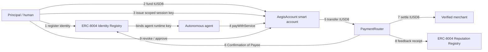

# Architecture

## System map

## Contracts

### `AegisAccount`
The principal's tUSD8 vault. Immutable `owner`, `token`, `identity`, `reputation`, and `router`.

`Session` fields: `active`, `totalCap`, `spent`, `perTxCap`, `expiry`, `recipient` (+`recipientLocked`), `agentId`, `approvalThreshold`, `nonce`.

Authorization for an agent call (`pay` / `payWithService`):

1. `active == true`
2. `block.timestamp <= expiry`
3. `amount > 0 && amount <= perTxCap`
4. `spent + amount <= totalCap`
5. if `recipientLocked`, target must equal `recipient`
6. if `amount > approvalThreshold`, a **single-use** owner approval for `(agent, target, amount, nextNonce)` must exist

Then state is updated (effects) and only afterwards is tUSD8 transferred (interactions). `PaymentExecuted` is emitted with the session nonce, giving a gap-free audit trail.

Safety properties:
- The agent key holds **no funds itself**; it can only spend from the account under policy.
- Revocation is one owner transaction and immediately invalidates the key.
- Approvals are consumed on use, so a captured approval cannot be replayed.
- The agent cannot call arbitrary contracts (`delegatecall` is absent), so prompt-injection into the agent cannot drain more than the session policy allows.

### `PaymentRouter`
Merchant registry + settlement hook.

- `registerMerchant(name, identityId)` requires `identity.isAuthorized(identityId, msg.sender)` — the "Confirmation of Payee" check.
- `settle(account, merchant, amount, serviceRef, agentId)` requires the merchant be registered, forwards tUSD8, emits `ServiceSettled`, and writes feedback to both agent and merchant identities.
- `serviceRef` is a `bytes32` invoice/call id, so each agent payment maps to a business event.

### `AegisFactory`
One account per principal, discoverable via `accountOf(owner)`. The router is injected in the account constructor so no privileged post-deploy initializer is needed.

### ERC-8004 adapters
`MockIdentityRegistry` and `MockReputationRegistry` implement the minimal ERC-8004 surfaces used here. On the live testnet, swap in the official registry addresses if published; the interfaces are intentionally tiny to make that swap a config change, not a rewrite.

## Threat model

| Threat | Mitigation |
|---|---|
| Compromised agent key | Spend cap, per-tx cap, expiry, payee lock, instant revocation; key never holds funds |
| Prompt injection telling agent to "pay everything" | Amounts above `approvalThreshold` require a human, single-use approval |
| Malicious merchant | Must be ERC-8004-authorized and registered in router before settlement |
| Replay of an approval | Approval hash includes agent, target, amount and next nonce and is deleted on use |
| RPC failure / retry during payment | Runner retries idempotently on reads and waits for receipts; duplicated approval hashes cannot be replayed |
| Reentrancy | Checks-effects-interactions, immutable trusted token, no agent-controlled callbacks |
| Validator timestamp nudging | Expiry granularity is hours/days; a few seconds of drift is immaterial |

## Known constraints

- Aevum testnet requires `evm_version = "shanghai"`. Cancun builds deploy but fail with `invalid opcode: MCOPY`.
- Explorer contract verification is not available yet — link the repo + deployment transaction instead.
- `eth_getLogs` is capped at 1,000 blocks; the UI/runner uses direct contract reads rather than wide log scans.
- No WebSocket RPC — the runner polls over HTTPS.
- Faucet grants 5 tUSD8 per verified Discord member, so the live demo uses 4 + 8 units across two invoices only after topping up; the local Anvil demo mints freely.

## API reference (selected)

| Contract | Method | Purpose |
|---|---|---|
| AegisFactory | `createAccount() → address` | Get/create principal account |
| AegisAccount | `issueSession(agent, agentId, totalCap, perTxCap, expiry, recipient, approvalThreshold)` | Delegate limited authority |
| AegisAccount | `approvePayment(agent, recipient, amount, nonce)` | Pre-approve one high-value payment |
| AegisAccount | `payWithService(merchant, amount, serviceRef)` | Agent settlement call |
| AegisAccount | `revokeSession(agent)` | Kill switch |
| PaymentRouter | `registerMerchant(name, identityId)` | Confirmation of Payee |
| Identity | `register(uri)`, `setAgentAddress(id, addr)` | ERC-8004 identity binding |
| Reputation | `getSummary(agentId)` | Verify feedback count/score |

## Roadmap to mainnet

1. Replace ERC-8004 adapters with production registries and publish agent cards on IPFS.
2. Add ERC-4337 smart-account packaging (paymaster so fees can be paid in tUSD8).
3. Replace mock stablecoin with official tUSD8 everywhere (already done for chain 44005).
4. Add a subgraph indexing `PaymentExecuted` / `ServiceSettled` for instant dashboards.
5. Add multi-agent policies (per-merchant budgets, recurring allowances, time-windowed keys).
